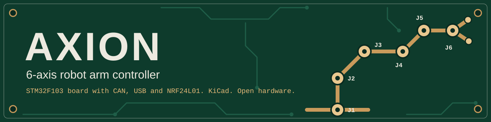
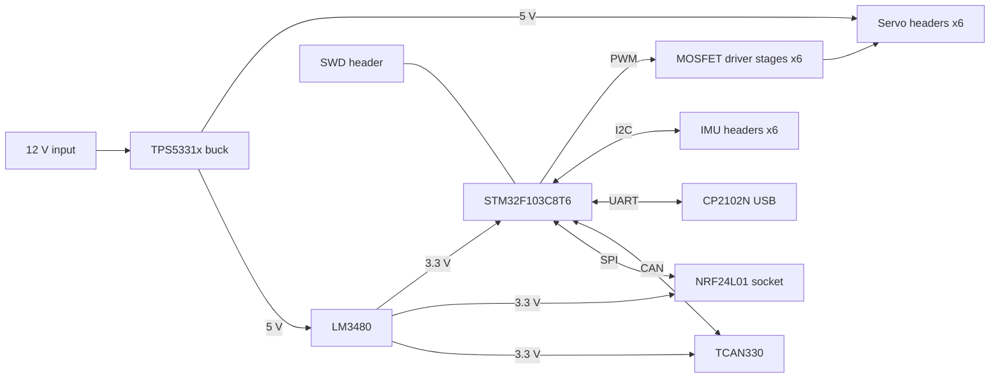

<p align="center">
 
</p>

<p align="center">
  
  
  
  
</p>

# Axion: 6-Axis Robot Arm Controller

Axion is an open-source controller board for a 6-axis articulated robot arm. It is built around an **STM32F103C8T6** and combines six servo outputs, six per-joint IMU inputs, and three ways to talk to the outside world: USB, CAN bus, and an NRF24L01 wireless link.

The whole board runs from a single **12 V** input. Everything else (5 V for servos and logic, 3.3 V for the MCU and radio) is generated on board.


---

## Table of contents

1. [Features](#features)
2. [System overview](#system-overview)
3. [Hardware details](#hardware-details)
4. [Pin mapping](#pin-mapping)
5. [Power design notes](#power-design-notes)
6. [PCB gallery](#pcb-gallery)
7. [Repository structure](#repository-structure)
8. [Bill of materials](#bill-of-materials)
9. [Getting started](#getting-started)
10. [Firmware](#firmware)
11. [Known limitations and design notes](#known-limitations-and-design-notes)
12. [Roadmap](#roadmap)
13. [Contributing](#contributing)
14. [License](#license)

---

## Features

| Area | What the board provides |
|---|---|
| Controller | STM32F103C8T6 (ARM Cortex-M3) |
| Servo outputs | 6 channels, each with its own MOSFET driver stage |
| Orientation feedback | 6 I2C headers, one per joint, for IMUs |
| USB | CP2102N USB-to-UART bridge |
| CAN | TCAN330 CAN transceiver |
| Wireless | NRF24L01 socket |
| Power input | 12 V |
| 5 V rail | TPS5331x buck converter |
| 3.3 V rail | LM3480 linear regulator |
| Programming and debug | SWD header |
| Design files | KiCad project, open hardware |

---

## System overview



Typical use: a host (PC over USB, another node over CAN, or a handheld over NRF24L01) sends joint targets. The MCU generates the servo PWM signals and reads the joint IMUs to track the arm's real orientation.

---

## Hardware details

### Main controller

The STM32F103C8T6 provides the PWM timers, I2C, SPI, UART and CAN peripherals this board needs. It is programmed and debugged over the SWD header.

### Servo outputs

Six servo channels, one per joint. Each channel has its own MOSFET driver stage between the MCU pin and the servo header, so the MCU only drives a gate rather than the servo signal line directly.

### IMU headers

Six I2C headers, one per joint. A mounted IMU at each joint lets the firmware measure the actual orientation of every link instead of trusting commanded angles.

> **Addressing:** many IMUs offer only two I2C addresses, so six on one bus will conflict. Document how this board resolves it (multiplexer, separate buses, or address strapping) in [docs/imu-addressing.md](docs/imu-addressing.md).

### Communication

| Interface | Part | Use |
|---|---|---|
| USB | CP2102N | Host connection, firmware console, command interface |
| CAN | TCAN330 | Multi-node or robust wired control |
| Wireless | NRF24L01 socket | Remote or handheld control |

### Power

| Stage | Part | Input | Output |
|---|---|---|---|
| Buck converter | TPS5331x | 12 V | 5 V |
| Linear regulator | LM3480 | 5 V | 3.3 V |

---

## Pin mapping

Fill this in from the schematic.

| Function | Signal | MCU pin | Notes |
|---|---|---|---|
| Servo 1 | PWM | TBD | MOSFET stage |
| Servo 2 | PWM | TBD | MOSFET stage |
| Servo 3 | PWM | TBD | MOSFET stage |
| Servo 4 | PWM | TBD | MOSFET stage |
| Servo 5 | PWM | TBD | MOSFET stage |
| Servo 6 | PWM | TBD | MOSFET stage |
| I2C | SCL / SDA | TBD | Shared by IMU headers |
| USB-UART | TX / RX | TBD | CP2102N |
| CAN | TX / RX | TBD | TCAN330 |
| NRF24L01 | SCK / MISO / MOSI / CSN / CE / IRQ | TBD | SPI |
| Debug | SWDIO / SWCLK | PA13 / PA14 | SWD header |

---

## Power design notes

| Rail | Source | Feeds |
|---|---|---|
| 12 V | External supply | Buck converter input |
| 5 V | TPS5331x | Servos, 5 V logic, LM3480 input |
| 3.3 V | LM3480 | MCU, NRF24L01, TCAN330, IMUs |

Things to check for your own build:

- **Servo current.** Hobby servos can draw well over 1 A each under load, and stall current is higher. Size the 12 V supply and the buck converter for the worst-case total, not the average.
- **Buck converter parts.** Confirm the inductor saturation current, input and output capacitors, and trace widths against the load.
- **3.3 V budget.** The LM3480 is a small linear regulator. Add up the MCU, NRF24L01, CAN transceiver and IMUs and compare with its rated output current.
- **NRF24L01 noise.** The radio is sensitive to supply noise. Keep decoupling capacitors close to its socket.
- **Servo transients.** Bulk capacitance near the servo headers helps stop current spikes from resetting the MCU.
- **Grounding.** Keep high-current servo return paths away from the MCU and IMU ground region.

---

## PCB gallery

| Board, view 1 | Board, view 2 |
|---|---|
|  |  |

| Front copper | Back copper |
|---|---|
|  |  |

---

## Repository structure

```
axion/
├── assets/            # Banner and images used in this README
├── hardware/          # KiCad project: schematic, PCB, footprints, symbols
├── gerbers/           # Fabrication outputs, ready for a PCB manufacturer
├── bom/               # Bill of materials and pick-and-place files
├── docs/              # Schematic PDF, pinout, IMU addressing, design notes
├── firmware/          # STM32 firmware (work in progress)
├── LICENSE
└── README.md
```

---

## Bill of materials

Key parts. Add the full BOM (with designators, values, footprints and supplier part numbers) to `bom/`.

| Part | Function |
|---|---|
| STM32F103C8T6 | Main microcontroller |
| CP2102N | USB-to-UART bridge |
| TCAN330 | CAN transceiver |
| NRF24L01 module | 2.4 GHz wireless link |
| TPS5331x | 12 V to 5 V buck converter |
| LM3480 | 5 V to 3.3 V regulator |
| MOSFETs (x6) | Servo driver stages |

---

## Getting started

### 1. Get the board made

1. Open `hardware/` in KiCad to review or modify the design.
2. Send the files in `gerbers/` to a PCB manufacturer.
3. Order the parts listed in `bom/` and solder the board.

### 2. Bring-up checklist

Do these in order, with a current-limited bench supply.

1. Visually inspect the board for solder bridges, especially around the buck converter and MCU.
2. Check for shorts between 12 V, 5 V, 3.3 V and ground before powering on.
3. Apply 12 V with a low current limit and check that the 5 V rail is correct.
4. Check that the 3.3 V rail is correct.
5. Connect an SWD programmer (for example an ST-Link) and confirm the MCU is detected.
6. Flash a simple LED blink or UART test.
7. Test each servo output separately, with no mechanical load first.
8. Connect IMUs and scan the I2C bus.
9. Test USB, CAN and the NRF24L01 link.

### 3. Connect the hardware

| Connector | What to connect |
|---|---|
| 12 V input | Power supply sized for your servos |
| Servo headers 1 to 6 | One servo per arm joint |
| IMU headers 1 to 6 | One IMU per joint |
| USB | Host computer |
| CAN | CAN bus (check termination) |
| SWD | Programmer |

---

## Firmware

Firmware is a work in progress. Planned structure:

```
firmware/
├── src/
│   ├── main.c
│   ├── servo.c        # PWM generation for 6 channels
│   ├── imu.c          # I2C reads, per-joint orientation
│   ├── comms_usb.c    # UART command interface
│   ├── comms_can.c    # CAN messages
│   └── comms_nrf.c    # NRF24L01 link
└── README.md
```

Planned build and flash steps:

```bash
cd firmware
# build command here
# flash command here (for example with st-flash or OpenOCD)
```

Planned features:

- Smooth, rate-limited servo motion
- Per-joint orientation from the IMUs
- A simple command protocol shared by USB, CAN and the radio link
- Forward and inverse kinematics for the arm

---

## Known limitations and design notes

This is a first prototype. Open points worth tracking as issues:

- [ ] Verify the 5 V buck converter against the real total servo current
- [ ] Verify the 3.3 V budget with the radio and all IMUs fitted
- [ ] Confirm the IMU addressing scheme for six devices
- [ ] Confirm CAN bus termination options
- [ ] Add reverse-polarity and overcurrent protection on the 12 V input if not already present

---

## Roadmap

- [x] PCB design in KiCad
- [ ] Order and assemble prototype
- [ ] Board bring-up and validation
- [ ] Basic firmware: servo control and IMU reads
- [ ] CAN and wireless command interface
- [ ] Kinematics and motion planning
- [ ] Mechanical design and full arm assembly
- [ ] Documentation and demo video

---

## Contributing

Contributions are welcome. Useful areas:

- Review of the power delivery for multi-servo setups
- Layout and routing feedback
- Firmware
- Documentation and test results from your own builds

Open an issue to discuss a change, or submit a pull request.

---

## License

Add a `LICENSE` file before publishing. Common open-hardware choices are CERN-OHL-P or CERN-OHL-S for the hardware, and MIT or Apache-2.0 for the firmware.
